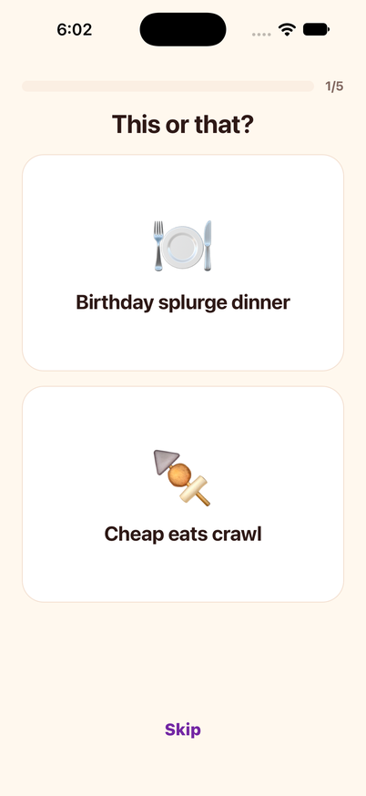
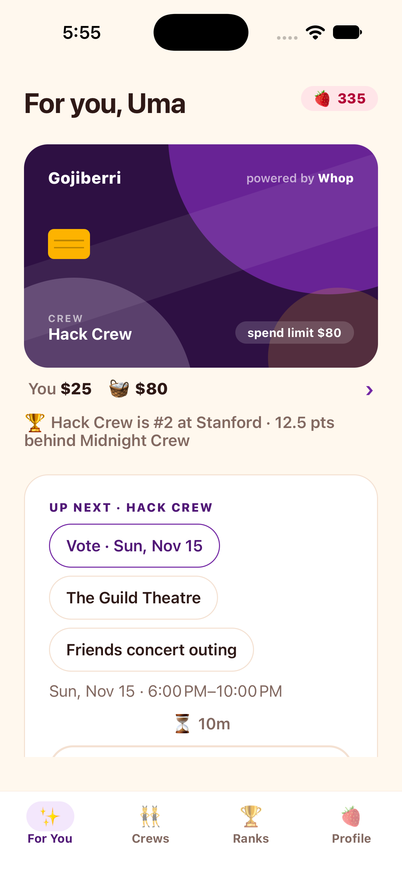
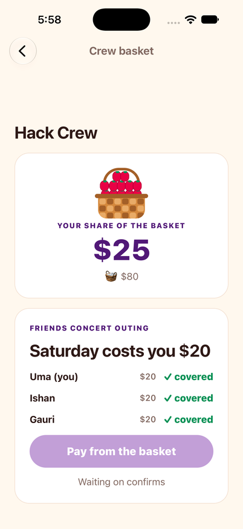
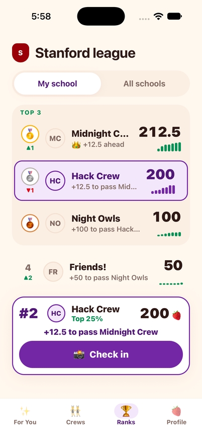
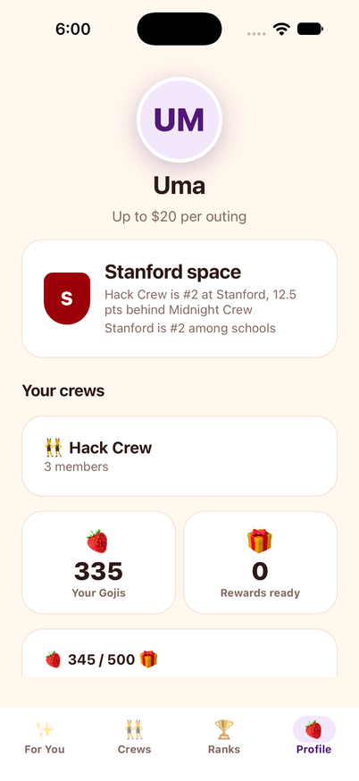
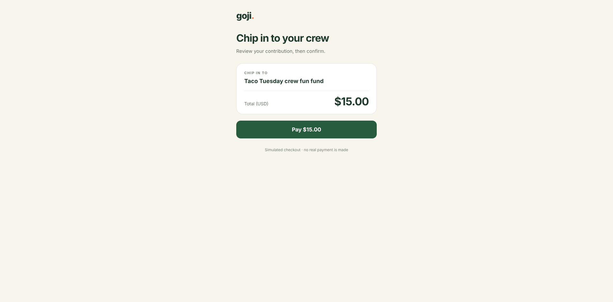
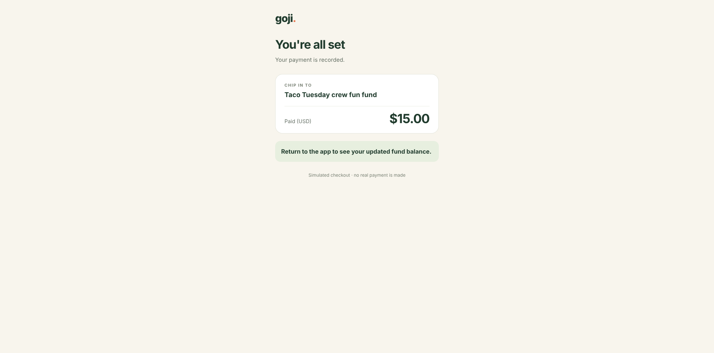

<div align="center">


# Gojiberri

**Go out. Go with friends. and Gojiberri!**

Plans out of the group chat and into the real world.

[Expo](https://expo.dev) · [Convex](https://convex.dev) · [Whop](https://whop.com) · [Supermemory](https://supermemory.ai) · Built with [Capy](https://capy.ai), tested on [Revyl](https://revyl.com)

</div>

---

Gojiberri is a consumer mobile app that gets friend groups off their phones: it learns what each friend loves, proposes one outing the crew will actually agree on, and pays for it with a **shared pot and a Whop card**. The more a crew explores together, the more Gojis it earns, and Gojis unlock real rewards from local businesses.

Built by three people in one day (Nov 15, 2026, at the YC/Capy/Revyl/Convex hackathon) and running live on a phone against a shared Convex deployment.

## Screenshots

| | |
|---|---|
|  |  |
| Taste swipes at onboarding | For You: one pick, predicted Gojis, novelty |
|  |  |
| The crew pot and Whop card, fair-split shares | Weekly crew league with standings and gaps |
|  |  |
| Local experiences, bought with Whop or the pot | Goji earning, taste chips |
|  |  |
| Whop checkout for a crew chip-in | Per-attendee fair-split receipt |

## Why friends come back every day

Gojiberri is a daily loop, not a one-time utility:

- **Something new every day.** For You regenerates from live taste memory, and every idea shows predicted Gojis and a personal novelty score, so today's pick is never yesterday's.
- **A reason to show up.** Photo check-ins, verified with geolocation plus a vision check, earn points, with a bonus when the whole crew shows up.
- **Stakes with friends.** Weekly crew leagues and school standings reset every week, and your gap to first place is pinned on screen.
- **Real money in the pot.** The crew's shared balance and Whop card make every plan a commitment friends already paid into.
- **A memory that gets smarter.** Every swipe, rating, and even ideas you passed on tune the next round of picks, and the app shows what it learned ("more climbing, less fancy dinners").

## How it works

1. **Join and tell it your taste.** Sign in, pick your school, set a budget, and swipe through this-or-that cards and a tap-to-pick taste step. Swipes become structured taste profiles in Convex and preference statements in Supermemory.
2. **For You: one great idea, not a feed.** A server-side feed (`recs.forYou`) scores real venues near campus within the crew's budget, then an LLM rerank blends each member's remembered tastes into a single top pick plus stretch picks that push the crew outside its comfort zone. Not feeling it? Half the crew opts out and Gojiberri regenerates instantly.
3. **Lock it, fund it, pay with Whop.** When the plan locks, the crew gets its shared pot and its Whop card. Everyone chips in through Whop checkout, and the crew pays for the outing with its card. Charging is fair-split: each attendee is charged only their share, a short pot refuses with the exact shortfall and a one-tap top-up, payments are idempotent, and every charge produces a receipt. Local businesses sponsor the outing by chipping into the pot the moment the plan locks.
4. **Show up, check in, earn.** Check in with a photo; Gojiberri verifies it with geolocation plus a vision check. Points come from group-plan check-ins only: base points, novelty bonuses, streaks, and a full-crew bonus, with a transparent breakdown on screen.
5. **Rate it, and it learns.** After the outing, the crew rates it. The rating updates that member's taste on the backend, the change shows up in the very next For You round, and the app tells you what it learned.
6. **Compete and spend.** Crews compete in weekly leagues within their school, and schools compete against each other, ranked by average weekly points per member rather than group size. Every 500 Gojis unlocks a reward, and crews can buy experiences sold by local businesses with Whop checkout or the crew pot.

## For local businesses

Businesses get their own dashboard with live bookings, earnings, and recent sales; a public sponsor page; single-use QR redemption codes for offers, rewards, and paid experiences, scanned business-side; and Whop transfers that settle experience revenue to the business. With Whop powering group payments and commerce, Gojiberri turns real-world friendships into a recurring revenue channel for local businesses: sustainable income for everyone, applied to the places friends actually go.

## Whop integration

Whop is the money backbone, not a bolt-on:

- **Checkout for three money flows**: crew pot contributions (`whop.createContributionCheckout`), sponsor quest packs (`whop.createSponsorCheckout`), and business experience products (`whop.createExperienceProduct`), all started from V8-compiled mutations so checkout opens instantly.
- **Signed webhook fulfillment** (`whop.handleEvent`): every payment is verified against Whop's signature and fulfilled idempotently, with payment verification before any purchase is recorded. A replayed or double-delivered webhook never double-credits.
- **The crew's Whop card**: issued on pot creation, charged per attendee with fair-split shares, shortfall-aware top-ups, and per-charge receipts.
- **Payouts**: `transferToBusiness` settles experience revenue to the selling business.
- **Demo mode** (`WHOP_MOCK=true`) mirrors the checkout flows end to end for a reliable live demo; the real API, webhook, and card code paths swap on with live keys.

## The AI

- **Supermemory** stores each friend's tastes: swipes, budget, ratings, and even rejected ideas, written as explicit preference statements that ground future picks.
- **OpenAI** powers the For You rerank, novelty reasons written in the second person, and the check-in vision check.
- **Taste learning** (`taste.ts`) updates a member's taste after every rating, with a visible "learned" summary, reflected in the next round of picks. Novelty scoring is deterministic from Convex history.

## Built in a day

- **Team of three**: Uma (app and UI), Ishan (core backend and schema), Gauri (payments, AI, data, sponsors).
- **~90 reviewed pull requests merged in one day**, directed through parallel [Capy](https://capy.ai) agents with code review on every change.
- **[Revyl](https://revyl.com)** ran the app on real iOS devices throughout, including profiling the checkout flow on-device.
- **133 unit tests** across money, recommendations, ratings, and taste (`npm test:whop`, `npm run typecheck`, `npm run typecheck:app`).

## Run it

```bash
npm install
npx expo start
```

The app falls back to the shared demo Convex deployment when no `.env` is set. To point it at your own backend:

```bash
cp .env.example .env   # set EXPO_PUBLIC_CONVEX_URL
npx convex dev         # push the backend
```

Whop environment variables: `WHOP_API_KEY`, `WHOP_COMPANY_ID`, `WHOP_WEBHOOK_SECRET`, and `WHOP_MOCK` (`true` mirrors checkout flows for demos). The webhook endpoint is `POST /whop/webhook` on your Convex deployment's site URL.

## Repo layout

```
app/            Expo Router screens (tabs, onboarding, plan, pot, business, story)
convex/         Typed backend: plans, votes, pots, funds, cards, points, ratings,
                taste, recs, rerank, novelty, sponsors, businesses, experiences,
                purchases, redemptions, notifications, crons, whop, whopMock
assets/         Icon, splash, images
```
